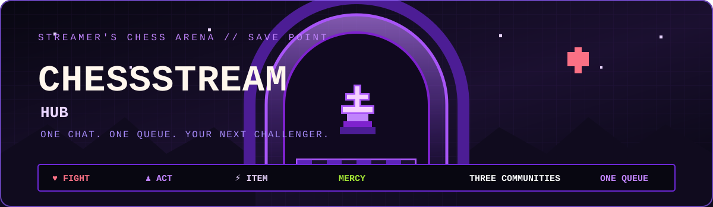
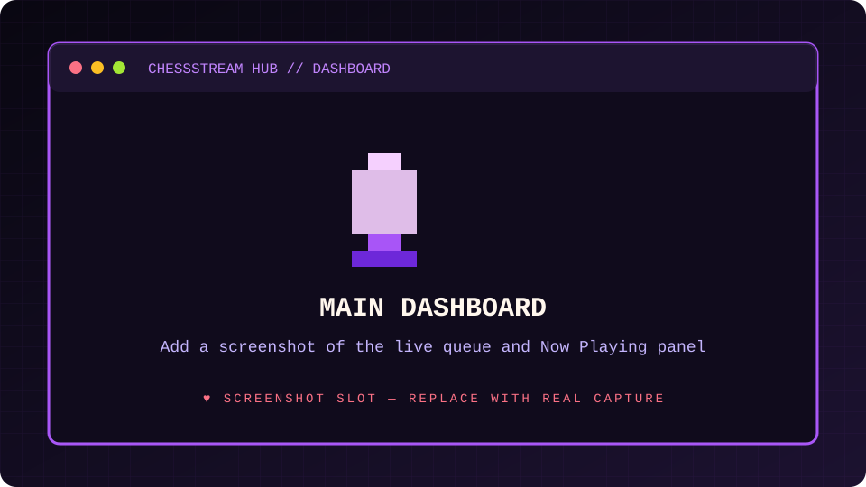
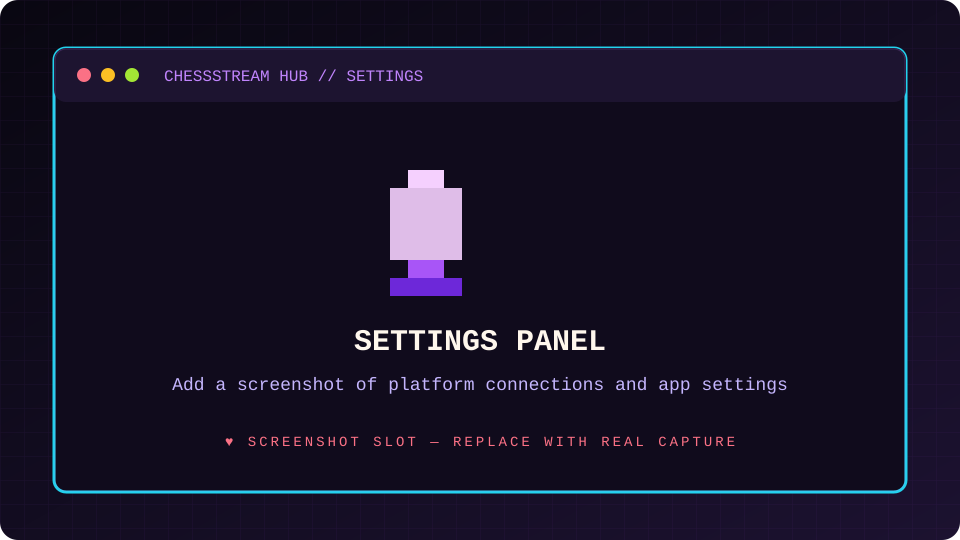
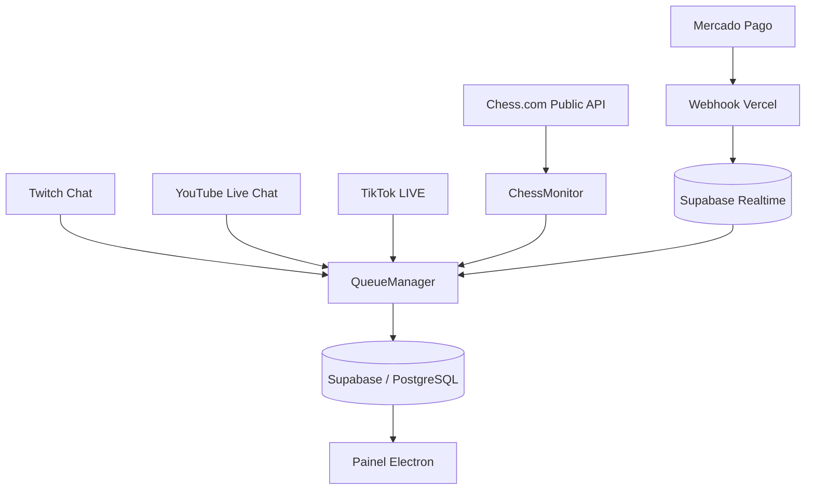

<!-- ChessStream Hub | Undertale-inspired pixel-art documentation -->
<div align="center">
  
  <br/>
  
  
  
  <br/>
  
  
  
  
  <p><strong>♥ ONE CHAT. ONE QUEUE. YOUR NEXT CHALLENGER.</strong></p>
  <p><em>Três comunidades. Um único campo de batalha. Uma fila de desafios para o Chess.com.</em></p>
</div>

---

## ♥ Press [START] — Sobre o projeto

**ChessStream Hub** é um aplicativo desktop desenvolvido com Electron para streamers de xadrez. Ele centraliza participantes vindos dos chats da **Twitch**, **YouTube** e **TikTok** em uma fila única. Ao enviar `!jogar <nick>`, o espectador solicita uma vaga e o aplicativo valida o nome de usuário no Chess.com.

O projeto combina uma interface leve em **HTML, CSS e Vanilla JavaScript** com módulos Node.js, persistência PostgreSQL e eventos Realtime pelo Supabase. Sua identidade visual segue uma estética de RPG retrô: fundo escuro, roxo neon, vermelho-coração e elementos pixel-art inspirados em jogos de aventura.

<div align="center">
  <strong>♥ FIGHT</strong> &nbsp; <strong>♟ ACT</strong> &nbsp; <strong>⚡ ITEM</strong> &nbsp; <strong>MERCY</strong>
  <br/><sub>Escolha seu movimento. Respeite a fila. Divirta-se.</sub>
</div>

## 🎮 Screenshots — A arena

Adicione capturas reais nos caminhos abaixo para exibir a interface do aplicativo:

| Painel principal | Configurações |
|:---:|:---:|
|  |  |
| `docs/assets/screenshots/dashboard-placeholder.svg` | `docs/assets/screenshots/settings-placeholder.svg` |

<div align="center">
  **Histórico de partidas e fila**
  <br/>
  
  <br/><sub>`docs/assets/screenshots/history-queue-placeholder.svg`</sub>
</div>

## ✨ Habilidades — Funcionalidades

- **♟ Fila multi-plataforma:** recebe comandos dos chats Twitch, YouTube e TikTok e reúne os espectadores na mesma fila persistida no Supabase.
- **🛡 Anti-duplicidade:** normaliza nomes e impede entradas repetidas sem diferenciar maiúsculas e minúsculas.
- **🟣 Twitch integrada:** autenticação no aplicativo, gerenciamento do token e sanitização para evitar prefixos `oauth:` duplicados ou credenciais malformadas.
- **🔴 YouTube Live Chat:** autenticação Google OAuth 2.0, descoberta de transmissão ativa e leitura do chat por polling a cada 15 segundos.
- **⚫ TikTok LIVE:** conexão pelo pacote `tiktok-live-connector`, com suporte opcional ao cookie `sessionid` quando a live exige sessão.
- **⚡ Resiliência:** ignora mensagens antigas durante a inicialização/reconexão e aplica novas tentativas com intervalos progressivos em falhas de rede ou rate limits.
- **🏁 Chess.com Monitor:** consulta a API pública aproximadamente a cada 20 segundos, acompanha partidas do streamer e interpreta vitória, derrota ou empate.
- **🎛 Painel do streamer:** área “Jogando agora”, fila reordenável, controles de gerenciamento, configurações e histórico diário de partidas.
- **💎 Alertas VIP:** recebe pagamentos aprovados pelo webhook do Mercado Pago, grava os dados no Supabase e atualiza o app via Realtime.
- **🧩 Interface leve:** renderer em HTML/CSS/JavaScript puro, com comunicação controlada pelo preload do Electron.

> **Como as integrações recebem mensagens:** Twitch e TikTok usam conexões/eventos próprios; o YouTube consulta o chat em ciclos de 15 segundos. Portanto, as três plataformas não usam o mesmo mecanismo de transporte.

## 🕹️ Como funciona



1. O espectador envia `!jogar <nick>` em um chat conectado.
2. O adaptador da plataforma encaminha o comando ao `QueueManager`.
3. O aplicativo valida o nick pela API pública do Chess.com e verifica duplicidade.
4. O participante é persistido no Supabase e aparece no painel.
5. O streamer chama o próximo desafiante. O `ChessMonitor` acompanha as partidas e registra os resultados detectados.

## ⚙️ Stack tecnológica

| Camada | Tecnologias |
|---|---|
| Desktop / backend | Node.js, Electron |
| Interface | HTML5, CSS3, Vanilla JavaScript |
| Banco e sincronização | Supabase, PostgreSQL, Supabase Realtime |
| Twitch | `tmi.js` |
| YouTube | YouTube Data API v3, `googleapis`, Google OAuth 2.0 |
| TikTok | `tiktok-live-connector` |
| Xadrez | API pública do Chess.com, Axios |
| Webhook VIP | Vercel Functions, Mercado Pago |

## 🚀 Instalação e execução

### Pré-requisitos

- Node.js e npm em versões compatíveis com as dependências atuais do projeto (Electron 41).
- Projeto Supabase configurado para a fila persistente.
- Credenciais de desenvolvedor das plataformas que serão conectadas.
- Git para clonar o repositório.

### 1. Clonar e instalar

```bash
git clone https://github.com/Lapllace/ChessStream.git
cd ChessStream
npm install
```

### 2. Criar o arquivo de ambiente

Windows PowerShell:

```powershell
Copy-Item .env.example .env
```

macOS / Linux:

```bash
cp .env.example .env
```

Preencha as variáveis aplicáveis no `.env`:

```dotenv
# Chess.com
CHESS_STREAMER_NICK=seu_nick_no_chess_com

# Twitch
TWITCH_USERNAME=usuario_do_bot
TWITCH_OAUTH_TOKEN=oauth:seu_token
TWITCH_CHANNEL=seu_canal

# TikTok
TIKTOK_USERNAME=usuario_da_live
TIKTOK_SESSION_ID=

# YouTube
YOUTUBE_CHANNEL_ID=seu_channel_id
YOUTUBE_LIVE_CHAT_ID=

# Supabase — necessário para a fila persistida
SUPABASE_URL=https://seu-projeto.supabase.co
SUPABASE_ANON_KEY=sua_chave_anon

# Mercado Pago / webhook VIP — opcional
MP_ACCESS_TOKEN=
# Obrigatório para o webhook: sem ele o endpoint responde 500 (fail-closed).
MERCADO_PAGO_WEBHOOK_SECRET=
MP_MIN_VALUE_CENTS=500
```

O arquivo `.env.example` do repositório contém a lista de variáveis e comentários de referência. Nunca publique tokens, cookies ou arquivos de credenciais.

### 3. Preparar o Supabase

1. Crie um projeto em [Supabase](https://supabase.com/).
2. Abra **SQL Editor**.
3. Revise e execute `supabase/schema.sql`.
4. Copie a Project URL e a chave pública/anon para o `.env`.
5. Habilite Supabase Realtime para a tabela `fila_vip`, conforme o schema.

**Atenção:** o schema atual contém permissões RLS amplas para algumas tabelas. Trate-o como configuração de desenvolvimento e revise as policies antes de utilizar dados reais ou disponibilizar o serviço publicamente. Consulte [SECURITY.md](docs/SECURITY.md).

### 4. Configurar autenticação das plataformas

- **Twitch:** gere as credenciais no [Twitch Developer Console](https://dev.twitch.tv/console/apps), configure canal/usuário e conclua o fluxo de conexão dentro do aplicativo.
- **YouTube:** crie um OAuth Client no [Google Cloud Console](https://console.cloud.google.com/) com acesso à YouTube Data API v3. Coloque o arquivo JSON no caminho esperado pelo carregador de credenciais do app e use a opção de login Google nas configurações. Confira também a configuração `build.files` do `package.json` antes de empacotar.
- **TikTok:** informe o nome de usuário da live. Para lives que exigem sessão, conecte a conta pelo aplicativo ou configure `TIKTOK_SESSION_ID`.
- **Chess.com:** informe o nick do streamer em `CHESS_STREAMER_NICK`.

Veja o [guia completo de setup](docs/SETUP.md) para os detalhes do OAuth e do webhook.

### 5. Iniciar o aplicativo

```bash
npm start
```

O painel desktop será aberto. Com o Supabase e ao menos uma plataforma configurada, envie `!jogar seu_nick` no chat de uma live de teste.

### 6. Gerar instalador

```bash
npm run pack   # empacota em dist/win-unpacked (sem instalador) — validação rápida
npm run dist   # gera o instalador NSIS em dist/ (ChessStream Hub Setup <versão>.exe)
npm run icon   # regenera build/icon.ico e build/icon.png
```

O `electron-builder` lê a configuração de `package.json` e gera os artefatos em `dist/`. O instalador NSIS é assinado apenas se um certificado estiver configurado; sem certificado, o Windows exibirá o aviso do SmartScreen.

Para habilitar o auto-update, publique o instalador e o `latest.yml` como assets de uma **Release** no GitHub e substitua os placeholders `owner`/`repo` em `build.publish` (`SEU_USUARIO_GITHUB`). O app instalado consulta as releases e aplica a atualização ao ser fechado.

```bash
gh release create v1.0.0 "dist/ChessStream Hub Setup 1.0.0.exe" dist/latest.yml dist/*.blockmap \
  --title "ChessStream Hub v1.0.0" --notes "Primeira versão comercial"
```

## 💬 Comandos de chat

| Comando | Disponibilidade atual | Ação |
|---|---|---|
| `!jogar <nick>` | Twitch, YouTube e TikTok | Valida o nick e solicita entrada na fila. |
| `!posicao` | Twitch, YouTube e TikTok | Informa a posição do espectador. |
| `!sair` | Twitch, YouTube e TikTok | Solicita remoção da fila. |
| `!proximo` | Twitch — streamer/moderação | Chama o próximo participante. |
| `!pular` | Twitch — streamer/moderação | Move o participante atual para o fim e chama o próximo. |
| `!fila pausar` | Twitch — streamer/moderação | Pausa novas entradas. |
| `!fila retomar` | Twitch — streamer/moderação | Retoma as entradas. |

Os comandos administrativos estão implementados no adaptador Twitch; o painel desktop também possui controles para gerenciar a fila.

## 🧱 Estrutura do projeto

```text
ChessStream/
├── assets/                  # Recursos estáticos e credenciais locais ignoradas pelo Git
├── docs/
│   ├── assets/screenshots/  # Capturas usadas nesta documentação
│   ├── SETUP.md             # Instalação e integrações
│   ├── ARCHITECTURE.md      # Componentes e fluxo de dados
│   ├── OPERATIONS.md        # Operação e comandos
│   └── SECURITY.md          # Segredos, RLS e webhook
├── src/
│   ├── main/                # Processo principal, IPC, configurações e Supabase
│   ├── preload/             # Ponte segura entre main e renderer
│   ├── renderer/            # HTML, CSS e JavaScript da interface
│   ├── chat/                # Adaptadores Twitch, YouTube e TikTok
│   ├── chess/               # Monitoramento de partidas no Chess.com
│   └── queue/               # Regras e persistência da fila
├── supabase/
│   └── schema.sql           # Tabelas, índices, policies e Realtime
├── vercel-webhook/
│   └── api/webhook.js       # Entrada de notificações do Mercado Pago
├── .env.example
├── package.json
└── README.md
```

## 📚 Documentação

- [Setup e credenciais](docs/SETUP.md)
- [Arquitetura e fluxo de dados](docs/ARCHITECTURE.md)
- [Operação e comandos](docs/OPERATIONS.md)
- [Segurança e checklist de produção](docs/SECURITY.md)

## 🗺️ Roadmap — próximos turnos

- [ ] Adicionar screenshots reais e um GIF de demonstração.
- [ ] Criar testes automatizados para os adaptadores e a fila.
- [ ] Restringir as policies RLS antes de produção.
- [ ] Validar a assinatura dos webhooks do Mercado Pago.
- [ ] Revisar o caminho das credenciais Google no processo de empacotamento.
- [ ] Documentar o processo de release e assinatura dos instaladores.

## 🤝 Contribuição

Sugestões e melhorias são bem-vindas. Abra uma issue com o comportamento esperado, o observado e os passos para reproduzir. Para mudanças maiores, descreva primeiro a proposta em uma issue.

## ⚖️ Avisos

ChessStream Hub é um projeto independente e não é afiliado, endossado ou mantido pela Twitch, YouTube, TikTok, Chess.com, Supabase, Vercel ou Mercado Pago. O uso das APIs e marcas de terceiros está sujeito aos respectivos termos e limites.

<div align="center">
  <br/>
  <strong>♥ YOUR TURN.</strong>
  <br/>
  <sub>Choose your move. Respect the queue. Have fun.</sub>
</div>
