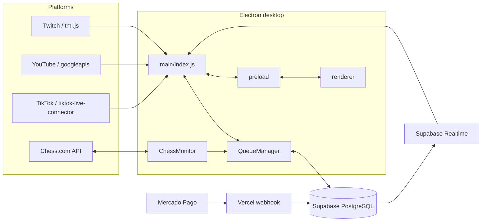

# 🧱 Architecture — ChessStream Hub

> A visão da arquitetura segue o tema de RPG do repositório, mas descreve os módulos existentes no código.

## Visão geral

ChessStream Hub é um aplicativo Electron organizado em processo principal, preload e renderer. Os adaptadores de chat entregam eventos ao gerenciador de fila; os dados persistentes são consultados e gravados no Supabase. O monitor de partidas consulta a API pública do Chess.com. O webhook de pagamentos é implantado separadamente como uma função da Vercel.

## Responsabilidades por módulo

| Caminho | Responsabilidade |
|---|---|
| `src/main/index.js` | Inicializa Electron, configura IPC, conecta integrações e coordena serviços. |
| `src/main/settings.js` | Lê e persiste preferências locais do aplicativo. |
| `src/main/database.js` | Cria o cliente Supabase a partir das configurações disponíveis. |
| `src/main/supabaseListener.js` | Escuta eventos Realtime relacionados à fila VIP. |
| `src/preload/index.js` | Expõe ao renderer somente a superfície de API definida pelo aplicativo. |
| `src/renderer/` | Contém HTML, CSS, interface, modais e traduções. |
| `src/chat/TwitchBot.js` | Conexão Twitch via `tmi.js`, autenticação e parsing de comandos. |
| `src/chat/YouTubeBot.js` | OAuth Google, descoberta da live e polling do Live Chat. |
| `src/chat/TikTokBot.js` | Conexão TikTok LIVE e tratamento de eventos/reconexão. |
| `src/queue/QueueManager.js` | Regras de fila, prioridade, persistência e histórico local da sessão. |
| `src/chess/ChessMonitor.js` | Consulta partidas do streamer e detecta resultados. |
| `supabase/schema.sql` | Estrutura SQL, índices, triggers, policies e configuração Realtime. |
| `vercel-webhook/api/webhook.js` | Recebe eventos de pagamento e grava pagamentos elegíveis na tabela VIP. |

## Fluxo de entrada na fila

1. Um adaptador recebe mensagem de chat.
2. O comando é interpretado e o nome do usuário/nick é normalizado.
3. O `QueueManager` valida o nick no Chess.com e verifica duplicidade.
4. O registro é persistido na tabela `public.queue`.
5. O renderer recebe atualizações para atualizar a fila visível.

O `QueueManager` chama `assertSupabase()` em operações centrais de leitura da fila; portanto, o banco precisa estar configurado para o fluxo normal de gerenciamento persistido.

## Integrações e periodicidade

- **Twitch:** eventos recebidos pela conexão `tmi.js`; o token é sanitizado para garantir um prefixo `oauth:` consistente.
- **YouTube:** `liveChatMessages.list` é consultado a cada 15 segundos após autenticação OAuth e descoberta/definição do `liveChatId`.
- **TikTok:** utiliza `WebcastPushConnection` de `tiktok-live-connector`; pode receber `sessionId` e aplica intervalo de reconexão maior quando identifica rate limit.
- **Chess.com:** consulta o endpoint mensal do jogador a cada 20 segundos, acompanha UUIDs de partidas e interpreta o resultado.
- **VIP:** a função Vercel busca o pagamento na API do Mercado Pago, verifica o status e o valor mínimo e insere na tabela `fila_vip`; o app recebe os eventos via Supabase Realtime.

## Priorização da fila

O `QueueManager` declara os níveis:

| Prioridade | Tipo |
|---:|---|
| 1 | Ultra VIP |
| 2 | Pagamento aprovado |
| 3 | Membro |
| 4 | Participante padrão |

Verifique as regras de ordenação no código antes de mudar os valores ou prometer uma política de precedência específica.

## Limites conhecidos

- O YouTube é consultado por polling, não por WebSocket.
- O webhook VIP é um serviço separado do aplicativo desktop.
- O histórico mantido em memória pelo gerenciador de fila é filtrado por data local da sessão.
- O schema atual precisa de revisão de RLS antes de exposição pública.

